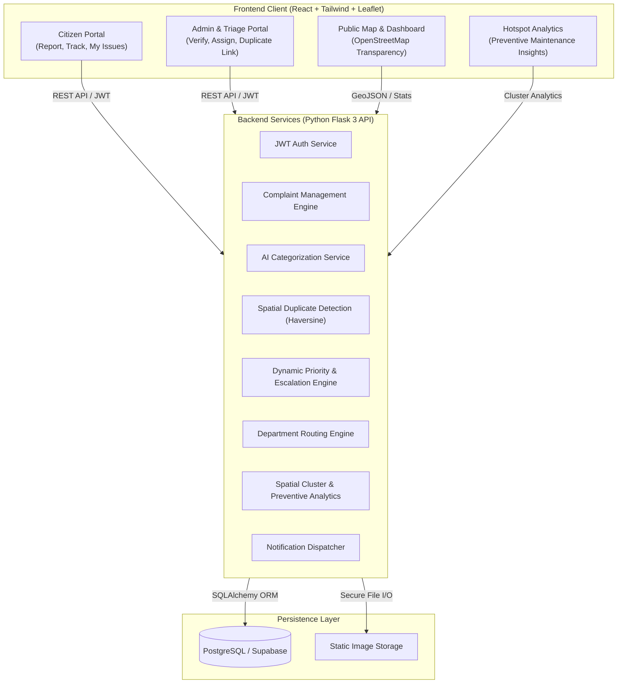
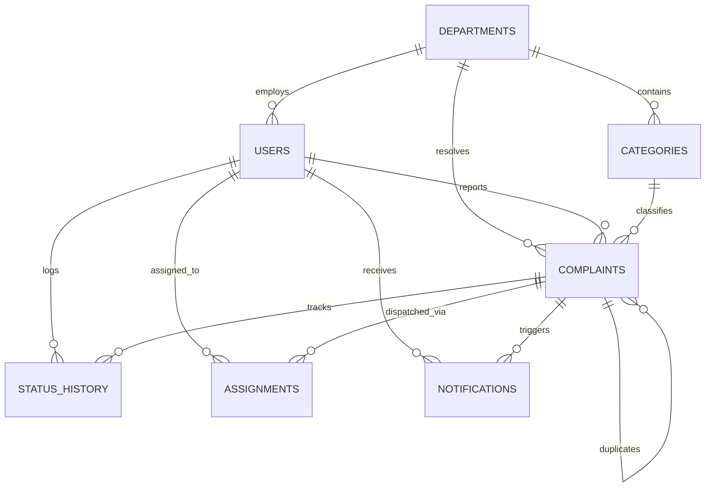

# CivicFix — Citizen Civic Issue Reporting & Accountability Platform

[](https://react.dev/)
[](https://tailwindcss.com/)
[](https://flask.palletsprojects.com/)
[](https://www.postgresql.org/)
[](https://www.openstreetmap.org/)

---

## 🏛️ Problem Statement

Citizens encounter overflowing garbage dumpsters, ruptured drainage channels, hazardous potholes, and broken streetlights, but frequently **do not know which municipal department to notify** or whether their grievances are ever investigated. 

**CivicFix** bridges this civic accountability void by providing a closed-loop platform that:
1. Facilitates structured citizen reporting with geo-tagged photos and location pins.
2. Applies **AI-assisted categorization** to route issues to appropriate municipal teams.
3. Automatically identifies **nearby duplicate complaints** using Haversine spatial proximity and NLP text similarity.
4. Computes **dynamic priority rules** based on severity, affected population, and aging escalation timers.
5. Provides **transparent tracking** across 6 explicit status states: `Submitted`, `Verified`, `Assigned`, `In Progress`, `Resolved`, and `Rejected`.
6. Tackles the **Advanced Engineering Challenge** by analyzing historical complaint density to detect recurring hotspots and recommend preventive maintenance strategies with root-cause factor attribution.

---

## 🏗️ System Architecture



---

## 🧩 Tech Stack

| Layer | Technologies |
|---|---|
| **Frontend** | React 18, Vite 5, Tailwind CSS, Lucide React, Leaflet.js, React-Leaflet, Axios |
| **Backend** | Python 3.12, Flask 3.0, Flask-SQLAlchemy, Flask-JWT-Extended, Flask-CORS, Werkzeug |
| **Database** | PostgreSQL 16 (production) with automatic SQLite zero-config fallback |
| **GIS / Mapping** | OpenStreetMap (OSM) tile server & Leaflet.js interactive maps |
| **Machine Learning / NLP** | TF-IDF token vectorizer, cosine similarity, Haversine geospatial proximity engine |
| **Deployment** | Docker, Docker Compose, Nginx reverse proxy |

---

## 🌟 Key Features

### 1. User Registration and Login
- Role-based authorization: **Citizen**, **Department Staff**, and **Administrator / Moderator**.
- Secure password hashing (`scrypt`) and JWT Bearer token generation.
- **One-Click Demo Personas** built directly into the UI for instant evaluation.

### 2. Multi-Step Complaint Submission Form
- Captures title, detailed description, severity assessment, and estimated citizen population impacted.
- Interactive OpenStreetMap pin with reverse geocoding to human-readable street addresses.
- Photo evidence upload with immediate thumbnail preview.

### 3. AI Complaint Categorization Assist
- Machine learning NLP engine evaluates titles and descriptions against category taxonomies.
- Suggests department routing, category, and severity with an explainable confidence bar (e.g. `94% Confidence`).
- Citizen can inspect the AI suggestion and confirm it with one click.

### 4. Spatial Duplicate Complaint Detection
- Computes Haversine distance:
  $$\text{dist}(p_1, p_2) = 2R \arcsin\left(\sqrt{\sin^2\left(\frac{\Delta\phi}{2}\right) + \cos\phi_1\cos\phi_2\sin^2\left(\frac{\Delta\lambda}{2}\right)}\right)$$
- Detects existing reports within 350 meters with category overlap or description similarity.
- Presents a non-blocking modal alerting citizens to similar open reports to consolidate field resources.

### 5. Dynamic Priority Assignment & Escalation
- Automated scoring model factoring in:
  - Base Severity weight (Critical = 50, High = 35, Medium = 20, Low = 10)
  - Impacted citizen population (1-5, 6-25, 26-100, 100+)
  - Report aging / SLA overdue clock (points added for unaddressed tickets > 48h)
- Composite priority tiers: `Low`, `Medium`, `High`, `Critical`.

### 6. Configurable Department Routing
- Automatically routes tickets to dedicated municipal boards:
  - **SWM**: Solid Waste Management & Sanitation
  - **ROADS**: Roads, Potholes & Infrastructure
  - **ELEC**: Electricity & Street Lighting
  - **BWSSB**: Water Supply & Sewerage Board
  - **PARKS**: Public Amenities, Parks & Playgrounds
- Allows manual re-assignment and multi-department transfers.

### 7. Complaint Status Tracking Across 6 States
Strict enforcement of workflow statuses:
1. `Submitted`: Citizen filed report; awaiting municipal moderator check.
2. `Verified`: Moderator confirms legitimacy and priority.
3. `Assigned`: Dispatched to specific field engineer or maintenance crew.
4. `In Progress`: Maintenance crew on site with materials/equipment.
5. `Resolved`: Work verified, sign-off notes recorded, resolved timestamp stamped.
6. `Rejected`: Duplicate of existing ticket or non-actionable submission.

### 8. Interactive OpenStreetMap Integration
- Embedded Leaflet maps for both the issue submission picker and public dashboard.
- Custom color-coded pin markers (Red=Critical, Orange=High, Amber=In Progress, Green=Resolved).
- Reverse geocoding using OpenStreetMap Nominatim API.

### 9. Admin & Staff Triage Dashboard
- Real-time work queues, SLA escalation timers, and department workload comparisons.
- In-place status update modal with audit trail recording.
- Field engineer assignment dispatch interface.
- Duplicate ticket merging mechanism.

### 10. Public Transparency Dashboard
- High-level civic transparency metrics (Total complaints, Resolution rate %, Average turnaround days).
- Comprehensive OpenStreetMap showing all city reports with filterable layers.
- Breakdown charts by category and department responsiveness.

### 11. In-App Notification System
- Notifies citizens when their tickets transition states or receive field notes.
- Notifies technicians when new issues are assigned to their queue.
- Interactive notification bell dropdown with unread badge and 1-click "Mark All Read".

### 12. Advanced Engineering Challenge: Recurring Hotspots & Preventive Maintenance
- Identifies spatial complaint clusters (recurring hotspots within 350m) using distance-based centroid aggregation.
- Generates **actionable preventive maintenance recommendations** instead of reactive patches.
- **Root-Cause Explainability**: Details specific factors driving chronic failures (e.g., undersized stormwater culverts, heavy transit axle loads, unshielded waste enclosures).

---

## 🗄️ Database Entity Relationship (ER) Diagram



---

## 📁 Complete Folder Structure

```
CivicFix/
├── backend/
│   ├── app/
│   │   ├── __init__.py          # Flask app factory, CORS, static uploads
│   │   ├── config.py            # Environment configurations
│   │   ├── extensions.py        # SQLAlchemy & JWTManager instances
│   │   ├── models/              # Relational models
│   │   │   ├── assignment.py
│   │   │   ├── category.py
│   │   │   ├── complaint.py
│   │   │   ├── department.py
│   │   │   ├── notification.py
│   │   │   ├── status_history.py
│   │   │   └── user.py
│   │   ├── routes/              # Modular API blueprints
│   │   │   ├── analytics_routes.py
│   │   │   ├── auth_routes.py
│   │   │   ├── complaint_routes.py
│   │   │   ├── dashboard_routes.py
│   │   │   ├── department_routes.py
│   │   │   └── notification_routes.py
│   │   ├── services/            # Core business logic
│   │   │   ├── ai_service.py
│   │   │   ├── duplicate_service.py
│   │   │   ├── hotspot_service.py
│   │   │   ├── notification_service.py
│   │   │   ├── priority_service.py
│   │   │   └── routing_service.py
│   │   └── utils/
│   │       ├── auth_helpers.py
│   │       └── file_helpers.py
│   ├── database/
│   │   ├── schema.sql           # Pure PostgreSQL DDL schema
│   │   ├── seed.py              # Synthetic demo dataset seeder
│   │   └── seed_data.sql        # Pure SQL seed file
│   ├── uploads/                 # Storage for citizen & resolution images
│   ├── Dockerfile
│   ├── requirements.txt
│   ├── .env.example
│   └── run.py                   # Backend entry point
├── frontend/
│   ├── public/
│   │   ├── logo.svg
│   │   └── favicon.ico
│   ├── src/
│   │   ├── components/
│   │   │   ├── AiSuggestionCard.jsx
│   │   │   ├── ComplaintsMap.jsx
│   │   │   ├── DuplicateWarningModal.jsx
│   │   │   ├── Footer.jsx
│   │   │   ├── HotspotMap.jsx
│   │   │   ├── MapPicker.jsx
│   │   │   ├── Navbar.jsx
│   │   │   ├── NotificationDropdown.jsx
│   │   │   ├── PriorityBadge.jsx
│   │   │   ├── StatusBadge.jsx
│   │   │   └── StatusTimeline.jsx
│   │   ├── context/
│   │   │   ├── AuthContext.jsx
│   │   │   └── NotificationContext.jsx
│   │   ├── pages/
│   │   │   ├── AdminDashboardPage.jsx
│   │   │   ├── HomePage.jsx
│   │   │   ├── HotspotsAnalyticsPage.jsx
│   │   │   ├── LoginPage.jsx
│   │   │   ├── MyComplaintsPage.jsx
│   │   │   ├── PublicDashboardPage.jsx
│   │   │   ├── RegisterPage.jsx
│   │   │   ├── SubmitComplaintPage.jsx
│   │   │   └── TrackComplaintPage.jsx
│   │   ├── services/
│   │   │   ├── api.js
│   │   │   ├── authService.js
│   │   │   ├── complaintService.js
│   │   │   └── dashboardService.js
│   │   ├── App.jsx
│   │   ├── index.css
│   │   └── main.jsx
│   ├── Dockerfile
│   ├── nginx.conf
│   ├── package.json
│   ├── tailwind.config.js
│   ├── vite.config.js
│   └── .env.example
├── docker-compose.yml           # Multi-container orchestration
├── INSTALLATION.md              # Detailed installation instructions
└── README.md                    # Project documentation
```

---

## 📡 REST API Reference Summary

### Authentication (`/api/auth`)
- `POST /api/auth/register` — Citizen account registration
- `POST /api/auth/login` — Returns JWT access token and user metadata
- `GET /api/auth/me` — Fetches current user profile and unread counts
- `GET /api/auth/demo-accounts` — Returns credentials for quick testing

### Complaints (`/api/complaints`)
- `POST /api/complaints/ai-categorize` — Predicts category, department, severity, confidence
- `POST /api/complaints/check-duplicates` — Checks for nearby active duplicates within radius
- `POST /api/complaints/upload-image` — Multipart upload of evidence photos
- `POST /api/complaints` — Submits new complaint with geo-coordinates and metadata
- `GET /api/complaints` — Filterable listing (`status`, `department_id`, `priority`, `search`)
- `GET /api/complaints/my` — Returns current logged-in citizen's complaints
- `GET /api/complaints/<id_or_tracking>` — Detailed complaint view with audit history
- `PATCH /api/complaints/<id>/status` — Updates status (`Submitted` &rarr; `Resolved`), adds notes
- `POST /api/complaints/<id>/assign` — Assigns technician to work order
- `POST /api/complaints/<id>/link-duplicate` — Marks ticket as duplicate of parent

### Analytics & Hotspots (`/api/analytics`)
- `GET /api/analytics/hotspots` — Geospatial clustering with preventive recommendations and factor explanations

### Dashboard Metrics (`/api/dashboard`)
- `GET /api/dashboard/public-stats` — Civic resolution rates, turnaround hours, category distributions
- `GET /api/dashboard/admin-stats` — Backlog metrics, unassigned counts, SLA overdue escalations

---

## 🛡️ Safety, Ethics, and Limitations

1. **Demonstration Environment**: CivicFix is designed as an accountability and demonstration platform. It does not claim an official municipal partnership without authorization.
2. **Privacy Preservation**: Citizen identity and phone numbers are protected from public exposure. Public dashboards display only issue descriptions, geo-locations, and resolution notes.
3. **Content Moderation**: All citizen reports pass through the `Submitted` state before verification to prevent harassment, offensive content, or false alarms.

---

## 📜 License
This project is open-source under the MIT License.
Built with dedication for the **Real-World Problem Solving Challenge**.
